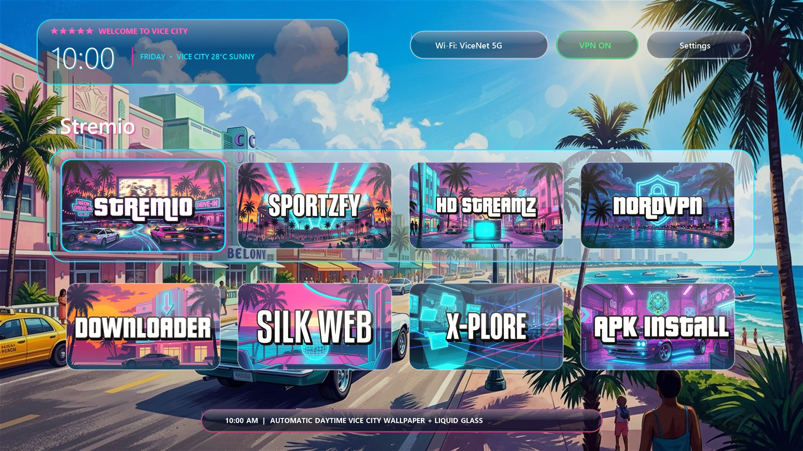
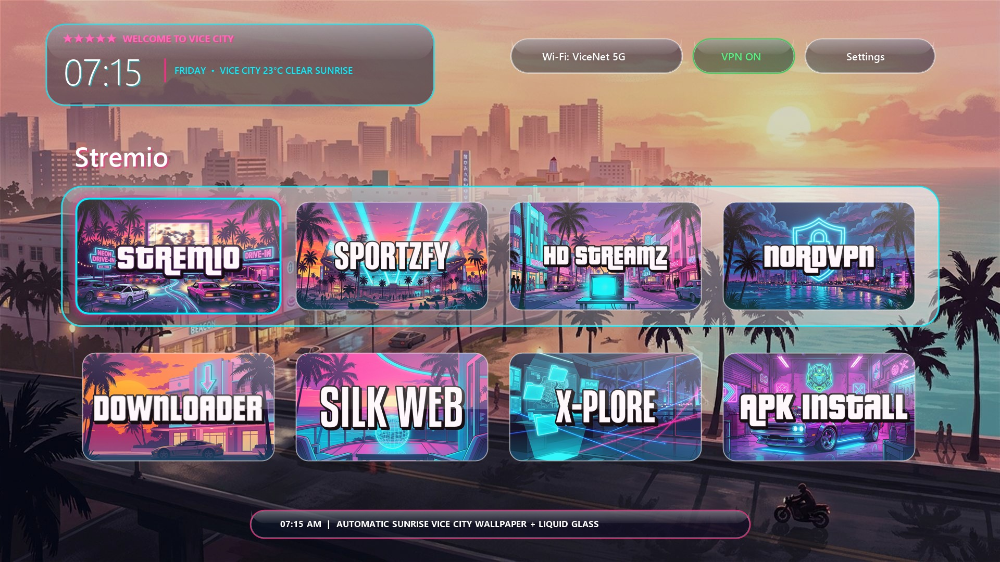
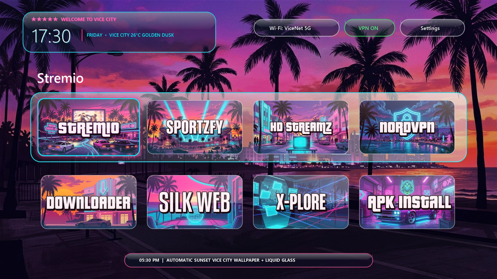
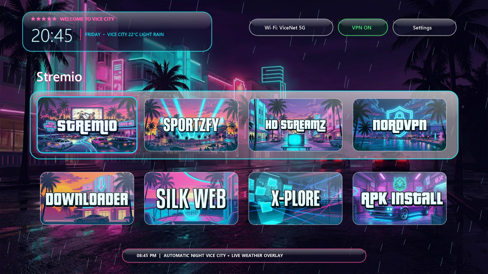

# CleanYourTV — GTA 6 Vice City Liquid Glass Edition (Fire TV & Android TV)

A custom **GTA 6 (Vice City) Liquid Glass** launcher & debloat suite for Amazon Fire TV and Android TV devices, built on top of [Gathin23/cleanyourtv](https://github.com/Gathin23/cleanyourtv).

---

## Preview Gallery — 4-Stage Automatic Time-of-Day & Liquid Glass UI

### 10:00 AM — Daytime Mode (`09:30 – Sunset - 1.5h`)


### 07:15 AM — Sunrise Mode (`Sunrise – 09:30`)


### 05:30 PM — Sunset Mode (`Sunset - 1.5h – Sunset + 30m`)


### 08:45 PM — Night Mode + Live Rain Overlay (`Night`)


---

## Features

1. **Refractive Liquid Glass HUD & App Tiles**
   - Top-left HUD capsule (`LiquidGlassDrawable`) wraps the 5-star Wanted greeting, clock, date, and live weather readout inside a frosted glass slab with a specular top highlight, cyan bottom refraction, and neon rim.
   - Every app tile across both the pinned dock and the app drawer is coated in a custom **Liquid Glass** finish (`AppAdapter.applyLiquidGlassFinish`) with diagonal glass sheen and automatic time-of-day colour grading.
   - Custom 16:9 Rockstar GTA 6 artwork banners included for `Stremio`, `Sportzfy`, `HD Streamz`, `NordVPN`, `Downloader`, `Silk Browser`, `X-plore`, `APKCombo Installer`, `MX Player`, and `Appstore` (plus automatic Liquid Glass styling for any other installed app).

2. **Automatic 4-Stage Time-of-Day Wallpapers (`morning`, `day`, `evening`, `night`)**
   - Automatically calculates local sunrise and sunset from your configured coordinates (`latitude` / `longitude`) and cross-fades the background wallpaper and app tile lighting across 4 daily phases:
     - **Morning (`morning.jpg`)**: Sunrise to 09:30 AM
     - **Daytime (`day.jpg`)**: 09:30 AM to 1.5 hours before Sunset (e.g. bright sunny Vice City Ocean Drive at 10:00 AM)
     - **Evening (`evening.jpg`)**: 1.5 hours before Sunset to 30 minutes after Sunset
     - **Night (`night.jpg`)**: Nighttime neon Vice City skyline

3. **Configurable Live Weather Backdrop & Readout**
   - Polls Open-Meteo (free, no API key required) every 15 minutes for your configured city and overlays subtle atmospheric weather effects (rain streaks, mist/fog, or cloud tint) over the current time-of-day wallpaper.

4. **Customizable Welcome Message & Location (No APK Rebuild Needed)**
   - Defaults to **`★★★★★  Welcome to Vice City`**, or pass `-Greeting`, `-WeatherCity`, `-Lat`, and `-Lon` when pushing the theme to personalize your TV in seconds.

5. **Safe Fire OS 7 Debloat Profile (`debloat-firestick-hd.txt`)**
   - Disables 59 Amazon bloatware, telemetry, ACR, ad-bidding, shopping, and background Alexa packages over ADB (no root required) while keeping Fire OS OTA system updates intact.

---

## Quick Start

### 1. Prerequisites
1. On your Fire TV / Android TV, enable **ADB Debugging** (**Settings → My Fire TV → Developer Options → ADB Debugging → ON**).
2. Find your TV's local IP address (**Settings → My Fire TV → About → Network**), referred to below as `<YOUR_TV_IP>`.
3. Set up the Python virtual environment once:
   ```powershell
   python -m venv cleanyourtv\tools\venv
   .\cleanyourtv\tools\venv\Scripts\python.exe -m pip install -r cleanyourtv\tools\requirements.txt
   ```

### 2. Install the GTA 6 Liquid Glass Launcher & Theme

#### Option A: Standard Install (`"★★★★★  Welcome to Vice City"`)
```powershell
powershell -ExecutionPolicy Bypass -File .\cleanyourtv\tools\theme.ps1 -TvHost <YOUR_TV_IP> .\themes\vice-city
```

#### Option B: Custom Welcome Message & Local Weather City
You can customize the top-left 5-star welcome banner and live weather city/coordinates right from the command line—no Android SDK or rebuild required:
```powershell
powershell -ExecutionPolicy Bypass -File .\cleanyourtv\tools\theme.ps1 `
  -TvHost <YOUR_TV_IP> `
  -Greeting "★★★★★  Welcome to My Lounge" `
  -WeatherCity "LONDON" `
  -Lat "51.5074" `
  -Lon "-0.1278" `
  .\themes\vice-city
```
*(Or edit `"greeting"`, `"weather_city"`, `"latitude"`, and `"longitude"` directly inside [`themes/vice-city/config.json`](themes/vice-city/config.json) before running `theme.ps1`.)*

---

## Common Commands

### Reset Theme Back to Built-in Defaults
```powershell
powershell -ExecutionPolicy Bypass -File .\cleanyourtv\tools\theme.ps1 -TvHost <YOUR_TV_IP> -Reset
```

### Apply the Fire TV Stick Debloat List
```powershell
powershell -ExecutionPolicy Bypass -File .\cleanyourtv\tools\disable.ps1 -TvHost <YOUR_TV_IP> .\debloat-firestick-hd.txt
```

### Restore Everything Back to Stock Fire TV Launcher
```powershell
powershell -ExecutionPolicy Bypass -File .\restore-firestick-hd.ps1 -TvHost <YOUR_TV_IP>
```

### Reorder Pinned Apps on the Top Row
1. Press the **Settings** gear in the top-right corner of the launcher (or press and hold **OK** on any app tile).
2. Select **Reorder** or **Edit dock** to arrange your pinned apps in any order.

### Close ADB Debugging When Finished (Recommended)
- **From your remote:** **Settings → My Fire TV → Developer Options → turn ADB Debugging OFF**.
- **Or from your computer:**
  ```powershell
  $env:TV_HOST="<YOUR_TV_IP>"
  .\cleanyourtv\tools\venv\Scripts\python.exe -I .\cleanyourtv\tools\tv.py "settings put global adb_enabled 0"
  ```

---

## Credits & License
- Built on [CleanYourTV](https://github.com/Gathin23/cleanyourtv) by **Gathin23** (MIT License).
- Weather data powered by [Open-Meteo](https://open-meteo.com/).
